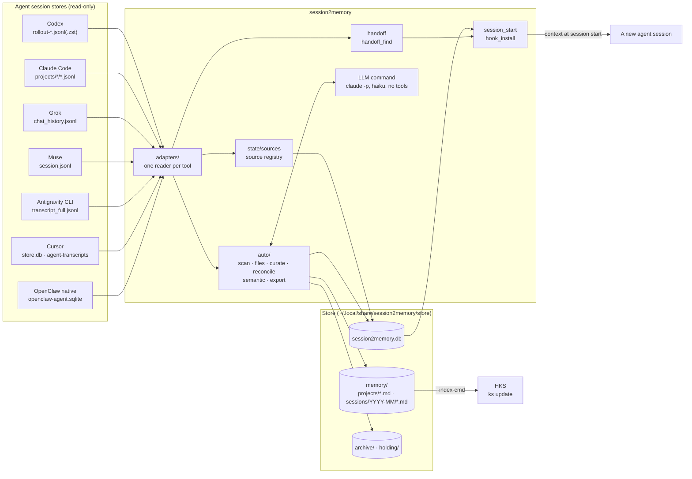
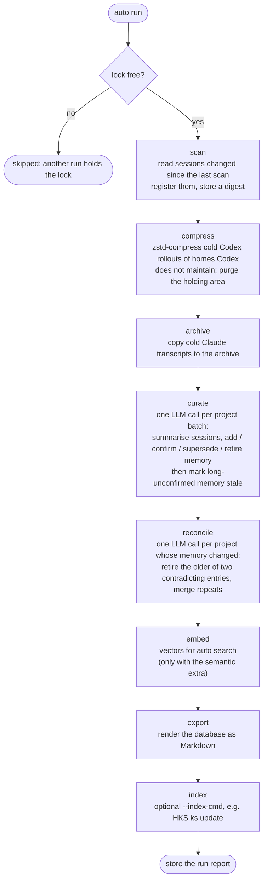
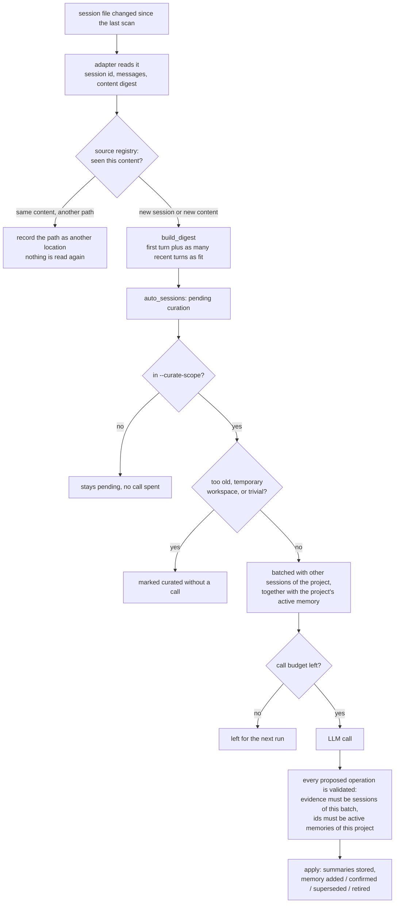
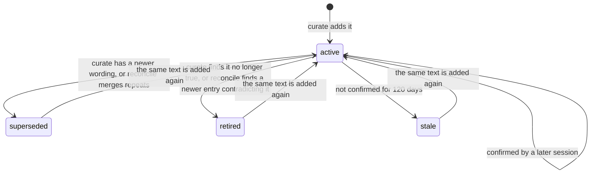
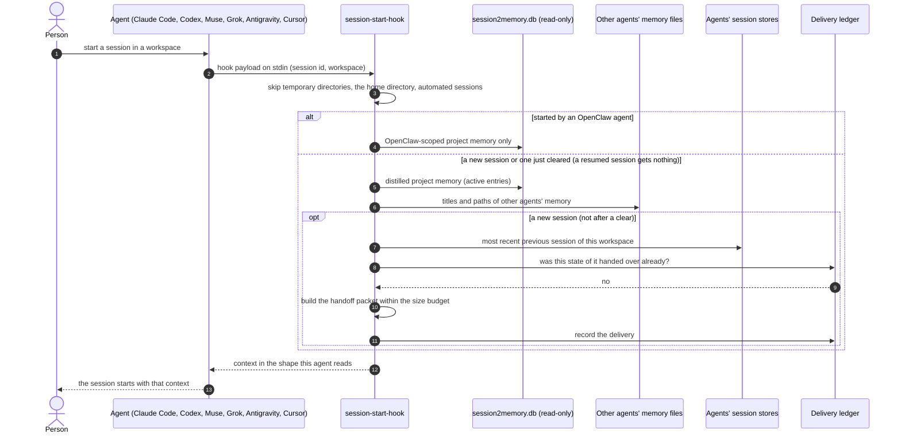
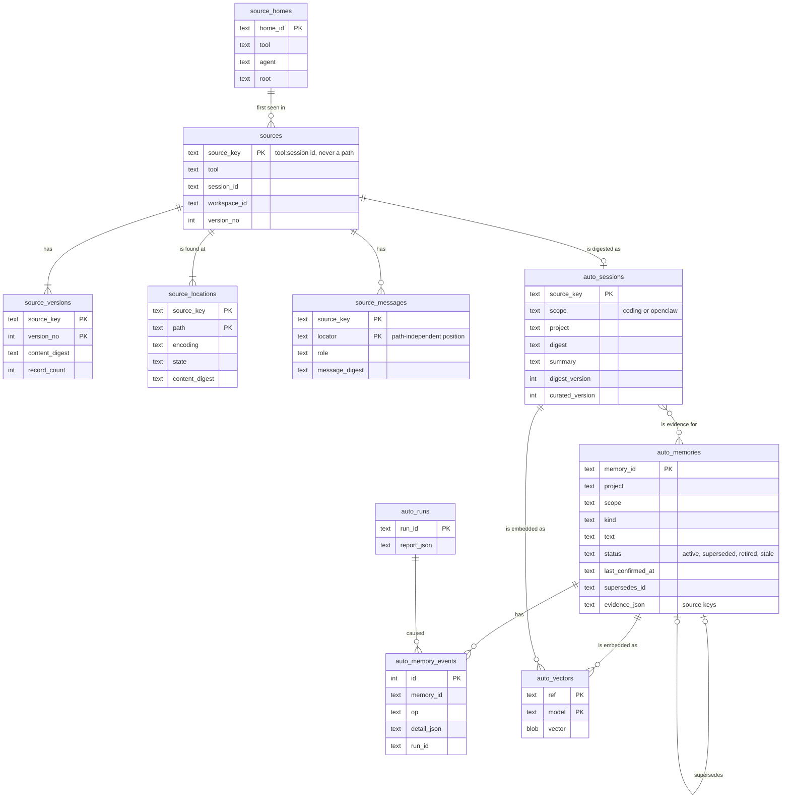
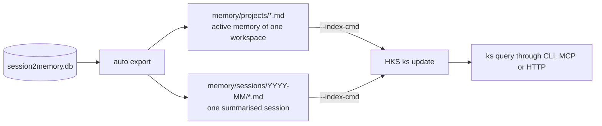

# Architecture, flows and sequences

Diagrams of what the code in `src/session2memory/` does today, written in Mermaid so
they are reviewed and changed with the code. The README describes the commands; when a
diagram and the code disagree, the code is right and this page needs fixing.

## 1. Components

session2memory only reads the agents' session stores. What it writes is its own store
(one SQLite database plus a rendered Markdown tree) and, when asked, one hook entry in an
agent's settings.

## 2. The unattended run

`session2memory auto run` (`auto/run.py`), usually from `scripts/nightly-auto.sh`. A
lock file keeps two runs apart. Every step reports on its own, and a failing step does
not stop the ones after it.

`--dry-run` works on an in-memory copy of the database and skips `curate`, `reconcile`,
`embed`, `export` and `index`.

## 3. From a session to memory

What `scan` and `curate` do with one session. The model never sees a transcript, only
the digest: the person's requests and the reply each one ended with.

## 4. Life of a memory entry

Nothing is deleted. An entry only changes status, and every change is written to
`auto_memory_events` with its reason and evidence. Only `active` entries are searched,
exported and injected.

Guards in `reconcile`: an entry is retired only when the reply names a listed entry that
is at least as recently confirmed and stays active, and one call can retire at most half
of what it was shown.

## 5. Session start

`session2memory session-start-hook`, installed by `hook-install`. It never fails the
session: any problem means nothing is injected.

Each agent takes the hook's answer in its own shape:

| Agent | Event | Answer |
| --- | --- | --- |
| Claude Code, Codex, Muse | `SessionStart` | `hookSpecificOutput.additionalContext` |
| Grok | `PostToolUse`, first tool call only | `hookSpecificOutput.additionalContext` |
| Antigravity CLI | `SessionStart` | `injectSteps` with a system message |
| Cursor | `sessionStart` | `additional_context` |

## 6. Data model

One SQLite database. The registry tables hold no transcript text.

## 7. Hand-over to HKS

HKS never reads an agent's session store. It indexes the Markdown that `export` writes.

